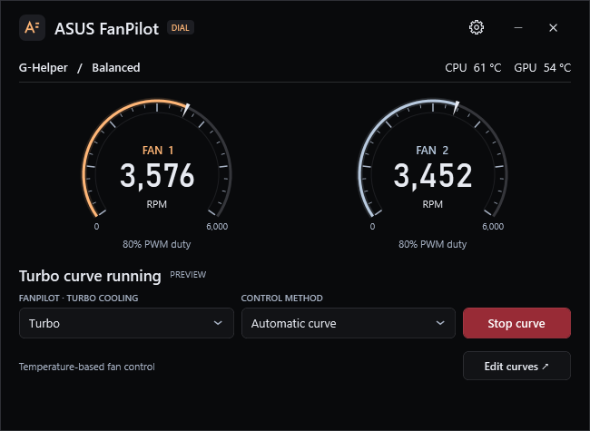
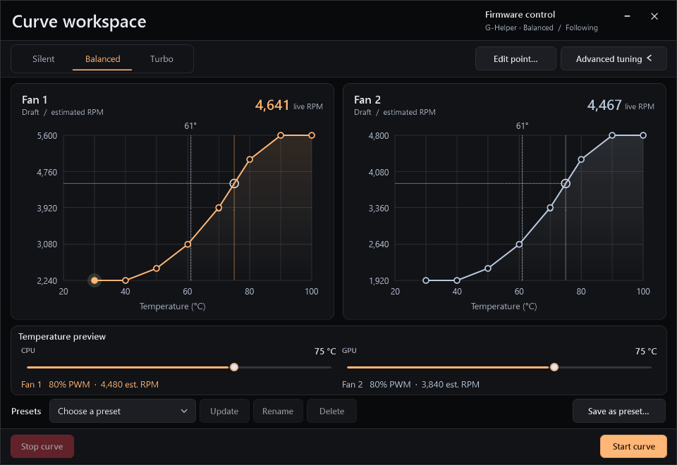
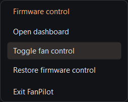

# ASUS FanPilot Dial

FanPilot Dial is an experimental Windows fan controller for compatible ASUS laptops. It lets you keep G-Helper in **Balanced** while running a different cooling curve. The dashboard shows each fan’s measured RPM and the available CPU and GPU temperatures.



*Screenshots use simulated fans.*

## Download

Use the [v1.0.0 Experimental Windows release](https://github.com/Cronesofdeath/ASUS-FanPilot-Dial/releases/tag/v1.0.0-experimental). Extract the full Windows ZIP. It includes the app, quick start, dependency setup script, and an EXE checksum. The EXE is unsigned.

To try the interface with simulated fans, open PowerShell in the extracted folder and run the following.

```powershell
& '.\ASUS FanPilot Dial.exe' --demo
```

## What you need for live control

| Requirement | Details |
| --- | --- |
| Windows | Windows 10 or 11 x64 with .NET Framework 4.7.2 or later |
| ASUS laptop | ASUS System Control Interface and a working compatible diagnostic interface. Compatibility varies by laptop model, firmware, and driver. |
| Local dependency files | Supported copies of ASUS `AsusWinIO64.dll` and Microsoft PsExec. The setup script checks their SHA-256 hashes before copying them. |
| NVIDIA GPU telemetry | A readable NVIDIA GPU temperature is required for RPM calibration. |
| G-Helper | Optional. Required when using **Follow G-Helper**. |

Get the supported dependency files from the sources in the [third-party notices](THIRD-PARTY-NOTICES.md). From the extracted release folder, supply their local paths to the setup script.

```powershell
.\setup-dependencies.ps1 -AsusLibrary 'C:\path\to\AsusWinIO64.dll' -PsExec 'C:\path\to\PsExec.exe'
```

The Windows ZIP contains only FanPilot and its documentation and setup script. After dependency setup, the app can run offline.

## Set a fan curve

1. Choose **Follow G-Helper** or select **Silent**, **Balanced**, or **Turbo** as a FanPilot cooling profile. When paired with G-Helper, the dashboard displays its performance mode separately.
2. Open **Edit curves**. If the RPM scale is unavailable, open **Advanced tuning**, scroll to **RPM calibration**, and choose **Measure max RPM** when the laptop is idle and cool.
3. Drag the points or use **Edit point** for exact values. Use the temperature sliders to preview the draft’s requested PWM and estimated RPM without sending a fan command.
4. Select **Start curve** to run it. While it is running, use **Apply changes** to update it. **Stop curve** requests a return to firmware control. Use **Fixed PWM** on the dashboard if you want a constant duty instead.



Save a draft as a named preset to reuse it later. **Advanced tuning** contains sensor sources, shared fan control, and response delays. The tray menu gives you quick access to the dashboard, fan control, and firmware restore. You can bind a one- to three-key shortcut in Settings.



## How it works

The local helper uses the ASUS diagnostic interface for tachometer readings and fan duty commands. In curve mode it evaluates temperature inputs against the selected profile, then applies the configured response delays and thermal safeguards. The RPM values along the curve are estimates based on calibration. The dashboard and graph headers display measurements from each fan.

FanPilot reads G-Helper’s selected mode when following it. You can choose a different FanPilot profile while G-Helper continues managing power and performance. If a firmware reset can’t be confirmed, the app shows **Firmware reset unconfirmed** and offers **Retry reset**. See the [quick start](docs/QUICKSTART.md) for calibration, handoff, and recovery details.

## Build and test

From the repository root in PowerShell on Windows:

```powershell
.\build.ps1
.\test.ps1 -SkipBuild
.\package.ps1 -SkipBuild
```

The EXE goes to `bin/app` and the release ZIP to `dist`. The desktop suite requires an interactive Windows session. The packaged v1.0.0 Experimental EXE passed 140 unit tests, 12 helper integration tests, and the simulated desktop suite. Native hardware compatibility still needs testing on each supported laptop configuration. See the [testing guide](docs/TESTING.md), [architecture](docs/ARCHITECTURE.md), and [contribution guide](CONTRIBUTING.md).

## License and credit

FanPilot’s source is available under the MIT license. It builds on the ASUS diagnostic and PWM work in Karmel0x’s AsusFanControl. The upstream copyright notice is included with the license. The ASUS library and PsExec are separate vendor components. [MIT license](LICENSE.txt) · [AsusFanControl](https://github.com/Karmel0x/AsusFanControl) · [Third-party notices](THIRD-PARTY-NOTICES.md)
